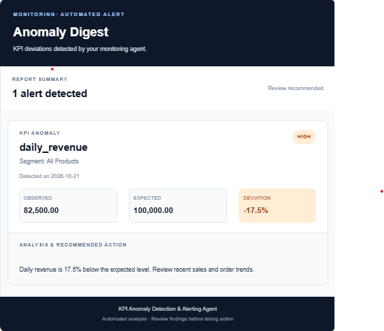

# KPI Anomaly Detection & Alerting Agent

An agent that watches business KPIs, flags abnormal movement, lists the segments that moved with it, writes a plain-language summary, and emails an alert, so nobody has to open a spreadsheet to find out a metric broke.

> **Status: functional prototype under evaluation.** The detection and alerting pipeline includes contribution attribution, numeric narration validation, forecast context, and a volume-price-mix variance bridge for headline sales anomalies. A reproducible comparative evaluation is now available. The experiment improves recall on injected anomalies but does not yet meet all recall and false-alarm targets; production scheduling and broader validation remain future work.

## The problem

Dashboards show what happened. They don't tell you what changed, why, or whether it matters, and alert systems that fire on every wobble get ignored. This project aims for the opposite: few alerts, each one explained, with duplicates suppressed.

## Sample alert

From a real run on the DataCo data (`--as-of 2017-07-07`), using the rule-based fallback summary:

> **[MEDIUM] sales, total, 2017-07-07**
> Observed 41,165.11 against an expected 30,348.33 (35.6% deviation). Possible drivers: category_name=Golf Apparel (124% vs expected); category_name=Golf Gloves (69% vs expected). This move warrants investigation.

### Example email digest



*Illustrative digest generated with synthetic KPI values. It highlights anomaly severity, observed versus expected performance, percentage deviation, and recommended investigation steps.*

## What works today

- **Config-driven.** One YAML file defines the date column, metrics, dimensions and thresholds. No metric names are hard-coded.
- **Correct ratio KPIs.** Ratios such as profit margin and late-delivery rate are recomputed from numerator and denominator, never averaged. Partial weeks are dropped so they cannot look like false drops.
- **Anomaly detection.** An STL decomposition estimates the weekly pattern; a trailing median of the deseasonalised values gives a robust level that is never fitted on the points being judged. Deviations are scored with MAD-based robust z-scores, with a floor so flat or sparse series cannot produce huge scores.
- **Persistence rule.** An anomaly needs 2 of the last 3 points flagged in the same direction, which suppresses one-day noise. A single extreme point (3x the z threshold) alerts immediately.
- **Latest-period, headline-only alerting.** Only the last few periods of the headline series can raise an alert. Segment series are used to list possible drivers.
- **Severity scoring and cooldown deduplication.** A repeat of the same metric, segment and direction inside the cooldown window is suppressed unless its severity escalates. Alerts are stored in SQLite.
- **LLM summaries with a fallback.** Groq writes the summary; on any API error the agent retries, then falls back to a rule-based summary.
- **HTML email alerting.** Sends formatted anomaly digests over SMTP using configurable recipients. The `--dry-run` mode generates a local HTML preview without sending an email.
- **Tests and CI.** `pytest` suite plus a GitHub Actions workflow.
- **Controlled evaluation.** Day-by-day replay with injected anomaly cases, benchmark comparisons, precision/recall/F1, detection delay, and false-alarm tracking.

## Status

| Component | State |
|---|---|
| Ingestion, validation, metric engine (additive and ratio) | Done |
| Detection, persistence, severity, dedup store | Done, tested |
| LLM narration with retry and fallback | Done |
| Email digest, dry run | Done |
| Segment drivers in alerts | Recent anomalous segments plus measured attribution when available |
| Root-cause attribution (additive contribution and ratio mix/rate effects) | Implemented with tests; attached to headline anomalies |
| ETS forecast context and volume-price-mix variance | Forecast outlook and reconciled sales variance context are attached to eligible headline sales alerts and rendered in the email digest; covered by tests |
| Numeric validator for LLM summaries | Implemented; invalid numbers trigger retry and deterministic fallback |
| Evaluation harness and controlled reports | Implemented; baseline and experimental results are published below |

## Controlled evaluation

The detector was evaluated using a reproducible, day-by-day replay of daily sales from the DataCo Smart Supply Chain dataset. Four anomaly patterns—spikes, drops, level shifts, and gradual drift—were injected at fixed dates and at 10%, 20%, and 50% magnitudes. The replay covered 241 days (2017-02-02 to 2017-09-30), using seed 42. On each replay date, the detector only sees data available up to that date.

### Baseline vs. experimental configuration

| Metric | Baseline | Experiment |
|---|---:|---:|
| Recall for injected anomalies >=20% | 27.5% | 45.0% |
| Precision | 100% | 98.5% |
| Median detection delay for anomalies >=20% | 1.0 day | 0.5 day |
| False alarms per 100 clean days | 1.24 | 1.66 |
| Top-contributor attribution accuracy within a dimension | 89% | 89% |

The experiment improves recall by **17.5 percentage points** and halves median detection delay, with a modest reduction in precision and an increase in false alarms. Neither configuration meets all predefined evaluation targets, so the experimental settings should be treated as a measured trade-off—not a universally optimal configuration.

### Additional findings

- Larger level shifts were the strongest case for the detector: recall was 80% for 20% shifts and 100% for 50% shifts in both configurations.
- Small spikes, drops, and gradual changes remain challenging. In the experiment, 50% spikes were detected in 60% of cases and 50% drops in 80% of cases; the baseline detected neither of those injected spike/drop cases.
- A fixed 20% threshold achieved higher overall recall in this evaluation but generated more false alarms: 5.39 per 100 clean days, compared with 1.24 for the baseline and 1.66 for the experiment.
- Attribution identified the injected segment as the top contributor within its own dimension in 89% of tested cases. Selecting the correct top contributor for the overall headline story was less reliable (11%), partly because dimensions such as market and region are nested.

### Limitations

This is a controlled experiment on one dataset, one random seed, and small sample counts per anomaly type and size. Injected anomalies are not a substitute for labelled real-world incidents. The clean historical series may also contain genuine anomalies that are counted as false alarms. Variance increases and missing-data gaps are not covered yet. Results should be treated as indicative, not as proof of production performance.

Detailed reports and machine-readable results are available in:
- `evaluation/controlled_baseline_v3/`
- `evaluation/controlled_experiment_v3/`

Threshold and configuration sweeps are retained in their corresponding evaluation directories as experiments, not as evidence that a single best production threshold has been established.

## Dataset

[DataCo Smart Supply Chain for Big Data Analysis](https://www.kaggle.com/datasets/shashwatwork/dataco-smart-supply-chain-for-big-data-analysis) (Kaggle), originally published on [Mendeley Data](https://data.mendeley.com/datasets/8gx2fvg2k6/5). Check the licence there before redistributing; the data files are not committed to this repository.

- **Monitoring window:** 2015-01-01 to 2017-09-30, 171,962 order lines, 5 markets (`dataset.end_date` in the config).
- **Why the cutoff:** from early October 2017 the data degenerates: a constant 68 to 69 order lines a day, only two markets and one or two categories a day. Those months are excluded.
- **Caveat:** the dataset looks partly synthetic with weak seasonality, so naturally occurring anomalies are few. Detection claims rest on injected anomalies described in the controlled evaluation above.

## Quick start

Requires Python 3.11.

```bash
git clone https://github.com/Mehak3010/AnalyticsWithAI.git
cd AnalyticsWithAI
python -m venv .venv
# Windows (Git Bash)
source .venv/Scripts/activate

# Windows (PowerShell)
# .\.venv\Scripts\Activate.ps1

# macOS / Linux
# source .venv/bin/activate
```

### Environment configuration

Create your local environment file from the example:

```bash
# Windows Git Bash
cp .env.example .env
```

Add your credentials and email settings to `.env`:

```env
GROQ_API_KEY=your_groq_api_key

MAILTRAP_HOST=live.smtp.mailtrap.io
MAILTRAP_PORT=587
MAILTRAP_USERNAME=api
MAILTRAP_PASSWORD=your_mailtrap_api_token
MAILTRAP_FROM_EMAIL=hello@demomailtrap.co
MAILTRAP_TO_EMAIL=your_registered_mailtrap_email
```

- `GROQ_API_KEY` is used for LLM-generated alert summaries. The agent has a rule-based fallback if narration fails.
- Mailtrap SMTP credentials are used to deliver the HTML anomaly digest.
- The demo sender domain is intended for testing and has delivery restrictions. Follow Mailtrap's requirements or configure a verified sender domain for other recipients.

**Security:** Never commit `.env` or expose API tokens. Use `.env.example` only for placeholders and non-secret defaults.


Download the dataset, put `DataCoSupplyChainDataset.csv` in `data/`, then build the tidy table and run:

```bash
python data/prep_dataco.py
python -m anomaly_agent.cli --config config/dataco_supply_chain.yaml --dry-run
```

To reproduce the historical demo without sending real email:

```bash
python -m anomaly_agent.cli --config config/dataco_supply_chain.yaml --dry-run --full-history
```

This scans all available history and is intended for demonstrations and experiments, not as the scheduled alerting mode.

| Option | Meaning |
|---|---|
| `--config PATH` | Config file (required) |
| `--dry-run` | Write the digest to `reports/last_email_digest.html` instead of sending email |
| `--as-of YYYY-MM-DD` | Treat later data as unseen; step the date forward to replay scheduled runs |
| `--full-history` | Scan the whole history instead of the latest periods (for experiments, not alerting) |

## Key configuration

```yaml
dataset:
  end_date: "2017-09-30"      # monitoring window
detection:
  z_threshold: 3.5
  persistence: {required: 2, window: 3}
  min_relative_change: 0.05
  mad_floor_pct: 0.02
alerting:
  min_severity: medium
  cooldown_days: 3
  alert_window: 3             # only the last N periods can alert
  headline_only: true         # segments explain, they do not alert
```

## Testing and verification

The project includes automated tests covering KPI computation, anomaly detection, persistence rules, severity scoring, attribution, forecasting, variance analysis, and alert generation.

The latest local verification completed successfully:

- **99 automated tests passed.**
- **Ruff linting passed.**
- **HTML email delivery and rendering** were verified through a controlled SMTP test.

Run the automated checks:

```bash
python -m pytest -q
ruff check .
```

The injection check uses the real dataset to test known scenarios: clean data produces no alert, a 3x one-day spike alerts on its exact date, a 1.35x one-day blip is suppressed, and a 1.5x three-day shift alerts once without an opposite-direction echo.

Deduplication, config-driven behaviour, and the LLM fallback were also checked manually. See [VERIFICATION.md](VERIFICATION.md) for the full verification log, including known limitations.

## Project structure

```
config/                 YAML configs
data/prep_dataco.py     raw CSV -> tidy table (raw files are not committed)
src/anomaly_agent/
  ingestion.py          load, window, validate
  metrics.py            additive and ratio series
  detection.py          baseline, robust z-scores, persistence
  severity.py           severity scoring
  store.py              SQLite alert log and deduplication
  narration/            Groq client, retry, fallback
  alerting/             email digest
  cli.py                entry point
  attribution.py         segment contribution and ratio mix/rate attribution
  forecasting.py        ETS forecast and seasonal-naive fallback
  variance.py            volume-price-mix revenue bridge
evaluation/              injection, baselines, replay harness and scoring
tests/                   pytest suite
check_injection.py      injection check on real data
```

## Future Improvements

1. **Production scheduling and monitoring:** Add scheduled execution, run-health monitoring, and operational failure alerts.
2. **Broader evaluation:** Test across additional datasets, random seeds, and anomaly scenarios, including variance increases and missing-data gaps.
3. **Detection quality:** Improve recall while controlling false alarms, and validate performance against labelled real-world incidents.
