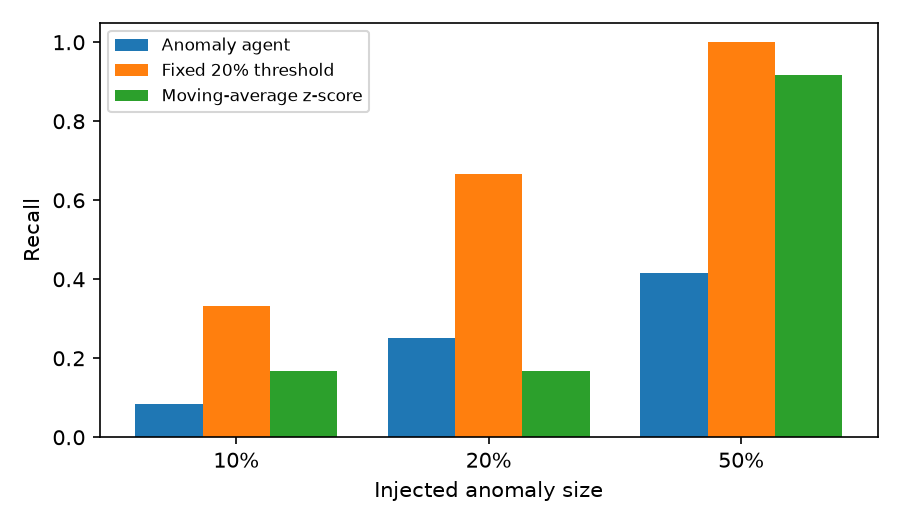

# Evaluation report

Metric: **sales** (daily total), dataset `data/dataco_tidy.csv`. Replay window 2017-02-02 to 2017-09-30 (241 days). Each anomaly type and size was injected at 3 dates (2017-02-28, 2017-08-06, 2017-09-23). Seed 42.

Each run replays the pipeline day by day: on every date the method only sees data up to that date.

## Results against targets

| Target | Goal | Result | Status |
|---|---|---|---|
| Recall, injected anomalies of 20% or more | >= 0.85 | 0.33 | missed |
| False alarms per 100 clean days | <= 1 | 1.24 | missed |
| Median detection delay in days (20% or more) | <= 2 | 2.0 | met |
| Top-1 attribution accuracy | >= 0.8 | 0.40 | missed |

## Detection by anomaly type and size (anomaly agent)

| Type | Size | Cases | Recall | Precision | F1 | Median delay (days) |
|---|---|---|---|---|---|---|
| spike | 10% | 3 | 0% | n/a | 0.00 | n/a |
| spike | 20% | 3 | 0% | n/a | 0.00 | n/a |
| spike | 50% | 3 | 0% | n/a | 0.00 | n/a |
| drop | 10% | 3 | 0% | n/a | 0.00 | n/a |
| drop | 20% | 3 | 0% | n/a | 0.00 | n/a |
| drop | 50% | 3 | 0% | n/a | 0.00 | n/a |
| level_shift | 10% | 3 | 33% | 100% | 0.50 | 7.0 |
| level_shift | 20% | 3 | 67% | 100% | 0.80 | 2.5 |
| level_shift | 50% | 3 | 100% | 100% | 1.00 | 1.0 |
| gradual_drift | 10% | 3 | 0% | n/a | 0.00 | n/a |
| gradual_drift | 20% | 3 | 33% | 100% | 0.50 | 7.0 |
| gradual_drift | 50% | 3 | 67% | 100% | 0.80 | 4.0 |

Recall is per injected case; precision is per alert raised that was not already present on clean data.

## Method comparison: recall by type and size

| Type | Size | Anomaly agent | Fixed 20% threshold | Moving-average z-score |
|---|---|---|---|---|
| spike | 10% | 0% | 0% | 0% |
| spike | 20% | 0% | 33% | 0% |
| spike | 50% | 0% | 100% | 100% |
| drop | 10% | 0% | 0% | 0% |
| drop | 20% | 0% | 67% | 0% |
| drop | 50% | 0% | 100% | 100% |
| level_shift | 10% | 33% | 100% | 33% |
| level_shift | 20% | 67% | 100% | 33% |
| level_shift | 50% | 100% | 100% | 100% |
| gradual_drift | 10% | 0% | 33% | 33% |
| gradual_drift | 20% | 33% | 67% | 33% |
| gradual_drift | 50% | 67% | 100% | 67% |

## False alarms on clean data

| Method | Distinct alerts | Per 100 days |
|---|---|---|
| Anomaly agent | 3 | 1.24 |
| Fixed 20% threshold | 13 | 5.39 |
| Moving-average z-score | 0 | 0.00 |

The clean series is the real DataCo history, so genuine anomalies in it count as false alarms. This makes the numbers conservative.

## Attribution accuracy

A segment's value on one day was scaled by 50% in 5 cases, and the attribution engine was asked to explain the resulting move in the total.

| Measure | Accuracy |
|---|---|
| Injected segment is the top contributor within its own dimension | 40% |
| Injected segment is the top contributor of the headline story | 0% |

The headline story picks the dimension where one segment explains the most. DataCo dimensions are partly nested (a region sits inside a market), so a parent segment can win that choice.

## Limits

- Anomalies are injected by scaling aggregated daily values (attribution cases scale raw rows).
- Variance increases and missing-data gaps are not covered yet.
- Results come from one dataset and one seed; sample sizes per cell are small, so treat them as indicative.
